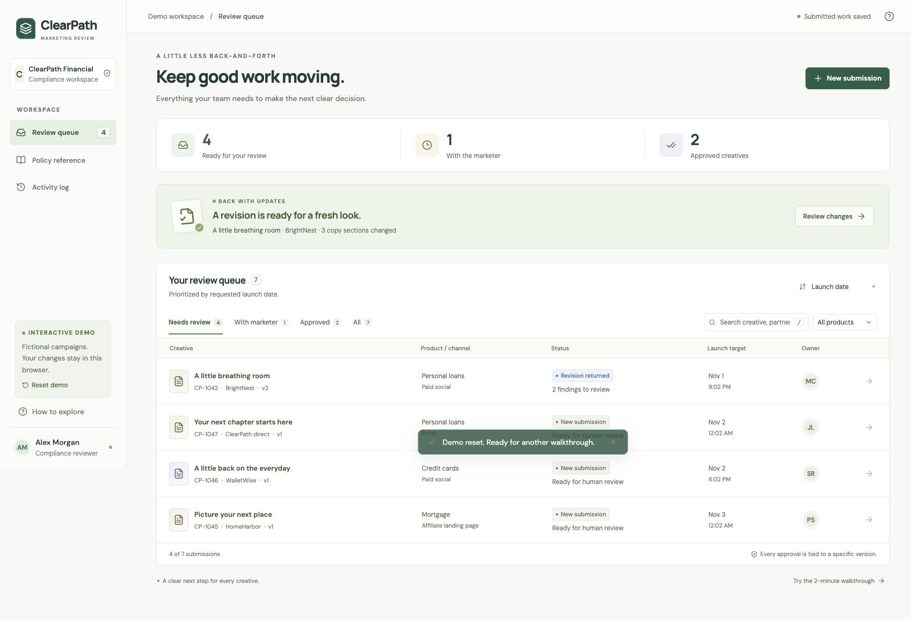
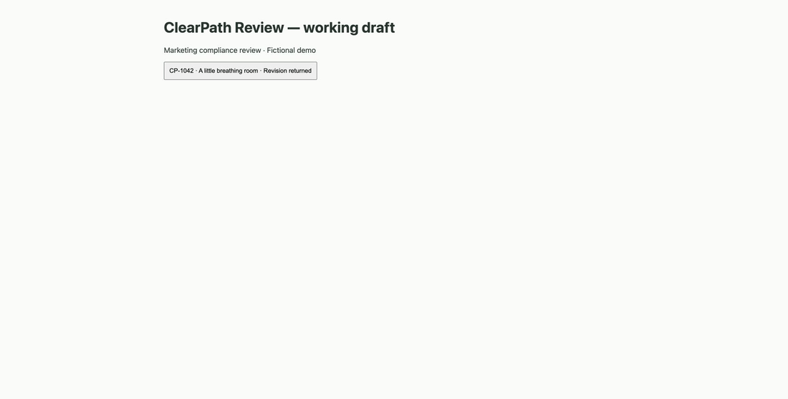
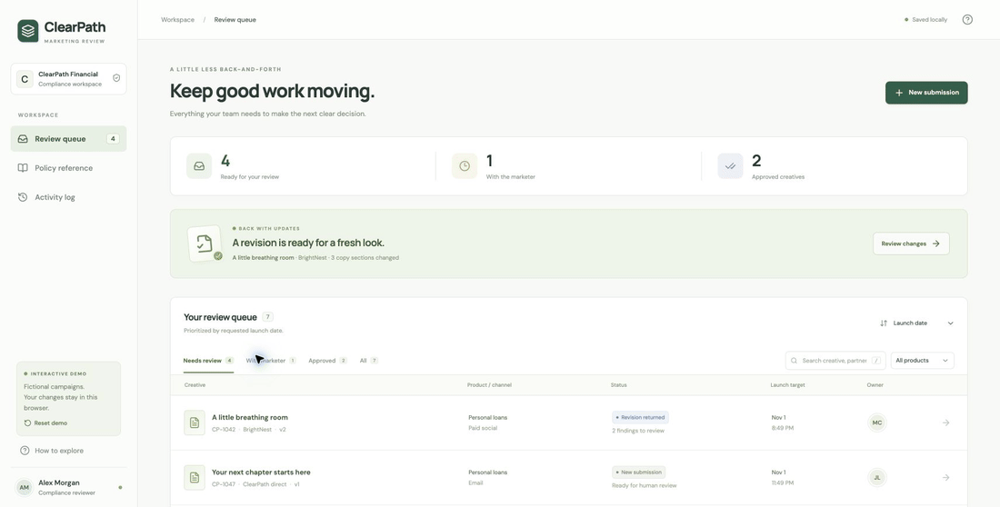
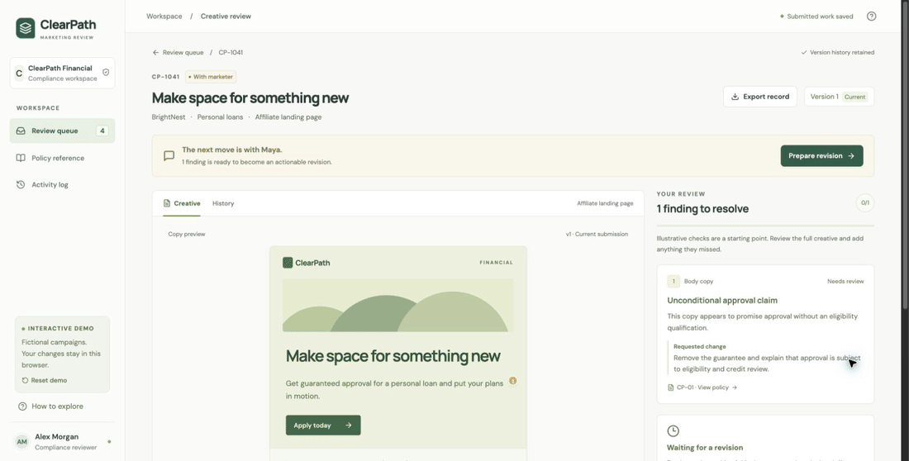
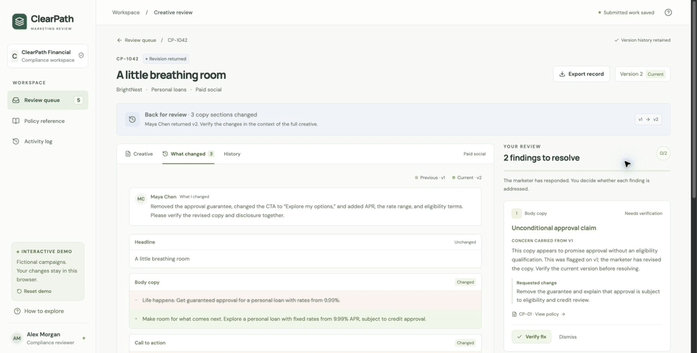
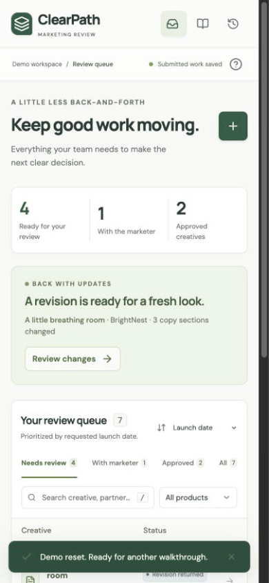

# ClearPath Review — Superseded First Draft

> [!CAUTION]
> **This is NOT the final delivered submission.** This repository is a dead-end first draft, retained only for historical context.
>
> **Final source:** [promptArmorTakeHome](https://github.com/cfireborn/promptArmorTakeHome)
> **Final deployed product:** [Relay / marketingreview](https://cfireborn.github.io/marketingreview/)

The final submission takes a different approach: compliance can offer a concrete, pre-approved correction that creative accepts without another review round. The notes and demos below describe only this abandoned first draft.

## Summary
A working prototype for getting financial marketing copy through compliance review with less back-and-forth.

I focused on the moment a revision comes back: what changed, why it changed, and what still needs a decision. Making that moment easier also gives the marketer a clearer checklist and the team a useful approval record.

## First-draft demo (superseded)
[Open the superseded first draft](https://cfireborn.github.io/promptarmor/) · [GitHub repository](https://github.com/cfireborn/promptarmor)

No signup. Fictional campaigns and policies. Submitted work stays in your browser; nothing is sent to an AI service or another person. Use **Reset demo** in the sidebar, or **How to explore → Restart demo** on mobile, to start again.

## Project Demo


### Try this first
1. Open **Review changes** on “A little breathing room.” Compare v1 and v2, then inspect the complete creative and its intended use.
2. Verify the two fixes. Approval stays unavailable until every finding has a disposition.
3. Approve the exact copy version and download its record.
4. Open **With marketer → Make space for something new → Prepare revision**. Remove the approval guarantee, describe the change, and submit. The new version comes back for human verification.

For a complete fresh loop, use **New submission → Use example**, add a reviewer finding, request changes, and submit a revision. The two roles share one browser in this demo.

## Description
ClearPath is a fictional consumer finance company offering personal loans, credit cards, and mortgage prequalification. Its marketing review process currently lives in Excel and email.

The hypothesis: some of the bottleneck comes from incomplete context and repeated review, not just slow issue detection. This prototype puts the copy, feedback, versions, owner, and next action in one place. It does not claim a measured throughput improvement; that needs testing with real reviewers.

## Requirements
- Searchable queue with product/status filters and launch-date or recency sorting.
- Complete intake: product, audience, channel, placement, partner, owner, requested launch, and copy.
- Field-level before/after comparison, full copy preview, and preserved version history.
- Actionable reviewer findings, explicit dispositions, revision responses, and human approval.
- A downloadable text record containing scope, every submitted version, findings, rationale, and history.
- Responsive layouts, keyboard access, draft-discard protection, and local save recovery.

## Technologies Used
- **React + TypeScript + Vite:** quick iteration, explicit workflow types, and a small static build.
- **Plain CSS + Lucide:** a consistent interface without a large component framework. DM Sans and Manrope are bundled locally; their licenses ship with the app.
- **Browser storage:** enough to demonstrate the whole loop without accounts or infrastructure. A deliberate prototype boundary.
- **Vitest + Playwright:** model invariants and actual browser workflows.
- **GitHub Pages:** the requested URL, with only `/promptarmor/` replaced during deployment.

## Setup Instructions
Node.js 22.12+ and npm; tested with Node 22.23.2. Browser tests use an installed Google Chrome.

```bash
git clone git@github.com:cfireborn/promptarmor.git
cd promptarmor
npm ci
npm run dev
```

Open the URL printed by Vite, normally `http://127.0.0.1:5173/`.

```bash
npm test             # model tests
npm run test:e2e     # starts/reuses local Vite; headless Chrome
npm run build        # typecheck + production bundle in dist/
npm run check:format
```

Validation at delivery: 28 model tests and 8 browser tests passing; production build passing; npm audit reports 0 vulnerabilities. Browser coverage includes revision handoffs, rationale requirements, exact-version approval, export, reload persistence, intake dates, filtering, dirty drafts, and a 390 × 844 mobile viewport.

## Development Progress
These are GIF walkthroughs assembled from actual browser captures taken at each stage. The rough first version is preserved. They are discrete interaction captures, not continuous screen recordings.

### Phase 1: First working draft


A plain queue, two checkboxes, and an approval action. Enough to exercise the basic interaction before styling it. [Checkpoint: milestone-1-draft](https://github.com/cfireborn/promptarmor/tree/milestone-1-draft).

### Phase 2: A review workspace


Added the queue, copy preview, comparison, policies, and complete handoff. This was also the first deployed version. [Checkpoint: milestone-2-workspace](https://github.com/cfireborn/promptarmor/tree/milestone-2-workspace).

### Phase 3: Make the handoff dependable


Increased reading size and contrast. Adversarial review caught ambiguous resolution actions, accidental draft loss, and silent replacement of unreadable saved data. Added rationale requirements, draft protection, recovery, and a real requested-launch field. [Checkpoint: milestone-3-handoff](https://github.com/cfireborn/promptarmor/tree/milestone-3-handoff).

### Phase 4: Approval detail and loading


Made the approval scope explicit and downloadable. Bundled fonts locally to remove the external font request; formatted the source and added browser regression coverage. [Checkpoint: milestone-4-decisions](https://github.com/cfireborn/promptarmor/tree/milestone-4-decisions).

### Phase 5: The small interaction details


Resolved findings collapse while retaining their original concern. Keyboard focus moves to the next finding or approval action. Checked the phone layout, added mobile demo reset, and separated unit/browser test discovery. [Checkpoint: milestone-5-polish](https://github.com/cfireborn/promptarmor/tree/milestone-5-polish).

### Time Spent
Work began November 1, 2026, Pacific time. Git records the initial guidance at 5:43 PM, first functional draft at 5:45, full workspace at 5:54, adversarial fixes at 5:58, and font/decision pass at 6:00. Final mobile checks, documentation, and deployment followed. These are wall-clock checkpoints with parallel AI work, not estimates of individual effort. The commit history is the detailed record.

## Assumptions
- The compliance reviewer is the primary user. An internal marketer coordinates direct and affiliate submissions.
- Missing context and revision rounds contribute meaningfully to the bottleneck. Queue capacity could turn out to be the larger issue.
- The prototype reviews copy. Approval binds a copy version to its stated product, audience, channel, placement, and partner. Final rendered placement needs separate verification.
- Automated assistance proposes concerns; people make decisions. The three checks here are transparent text patterns, not a live model or comprehensive rules engine.
- Faster actionable decisions and fewer revision rounds are the success measures. A pilot should track those alongside reviewer effort and missed issues.

## Scoping and Tradeoffs
I chose one complete review loop over campaign management, partner accounts, analytics dashboards, or live-site monitoring.

The preview is an illustrative layout, not a screenshot of a published ad. There is no upload/OCR flow, real authentication, shared backend, notifications, or tamper-resistant audit store. Local records are editable by the browser owner; simultaneous tabs are not coordinated. Drafts are not saved until submission. Submitted versions are retained, and approved records cannot be edited through the app.

Quick verification requires changed relevant copy and a cleared demo-pattern match. Otherwise resolution needs a rationale. Neither path replaces legal judgment. The internal example policies are informed by the advertising-review context in [CFPB Regulation Z § 1026.24](https://www.consumerfinance.gov/rules-policy/regulations/1026/24/), not a claim that those policies implement the regulation for every product.

## Design Choices
- Start with a returned revision so the useful part is visible immediately.
- Keep the original concern beside the changed copy. A marketer response never silently closes it.
- Keep full copy and intended use available: a small edit can change the meaning of unchanged text.
- Show real queue counts instead of invented time-saved metrics. Prioritize by the submitted launch target.
- Use restrained feedback: progress updates, a brief resolved-state transition, and focus on the next action. Respect reduced-motion preferences.

The current production app is about 430 KB uncompressed, including fonts; JavaScript is about 89 KB gzip. Development GIFs stay in the source repository and are not part of the app bundle. No before/after loading-time claim is implied.

## Deployment and Comparing Versions
The source is public in this repository. The existing Pages repository serves the app from its isolated `promptarmor/` directory. Its other files and deployment configuration are preserved.

```bash
npm run build
./scripts/deploy-pages.sh HEAD
```

Deployment requires SSH write access to `cfireborn/cfireborn.github.io`. The script snapshots the supplied build, guards changed paths, and pushes without force. Wait for the Pages workflow; [release.json](https://cfireborn.github.io/promptarmor/release.json) identifies the deployed source commit.

To compare an earlier milestone locally:

```bash
git worktree add /tmp/clearpath-draft milestone-1-draft
cd /tmp/clearpath-draft
npm ci
npm run dev -- --port 5174
```

To redeploy it, build that checkout, then run the current deployment script from the main checkout with `milestone-1-draft /tmp/clearpath-draft/dist` as arguments. Keep the ref and build matched. The script records the supplied ref; it does not prove which source produced an arbitrary build directory.

## Notes
I used AI for implementation and parallel adversarial review. The question review narrowed the project to the revision loop; later reviews produced concrete fixes to approval language, persistence, accessibility, and intake. Project guidance was adapted from my existing Unity project's `AGENTS.md`, keeping the minimum-effective-change principle and removing the game-specific material.

A misleading problem might be “we need faster approvals.” If reviewers spend their time reconstructing context, a faster issue detector leaves the coordination cost intact.

What becomes unnecessary when a submission carries its own history? Some status emails, copied spreadsheet rows, and “is this the latest version?” exchanges. The same work can improve reviewer throughput, marketer clarity, and the decision record together.
